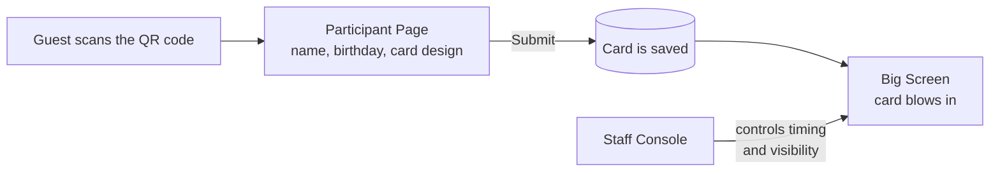

# How It Works

The experience connects three pages. Guests create cards on their phones, the cards are saved, and the big screen shows them. Staff decide how the big screen behaves from the console.

## The journey of one card

1. **Scan.** A guest scans the QR code printed at the venue. The Participant Page opens in the phone's browser. No app download or sign-up is needed.
2. **Fill in.** The guest enters a name or nickname and their birthday. A live preview of the card updates as they type.
3. **Design.** The guest picks a card colour, a text colour and a border, and agrees to have their card shown on the big screen.
4. **Submit.** The card is sent and saved. Only now is the day count revealed: *"Today is day N of my life."*
5. **Keep.** The guest can view the card full screen, flip it over, and save it to their phone as a picture.
6. **On the big screen.** The card joins a waiting line. When there is room on the big screen, it blows in from the right, floats for the time set by staff, then blows away to make room for others.

## How the day count is worked out

- The count is the number of calendar days from the guest's birthday to today. On the day someone is born, the count is 0.
- "Today" follows the event's local time (Malaysia time), no matter which time zone a guest's phone is set to.
- The count is calculated again when the card is saved, so the number on the card is always correct and cannot be changed by the guest.

## Two ways to put cards on the big screen

Staff choose one of two modes in the console.

| Mode | What happens |
| --- | --- |
| **Auto** (default) | Each card goes up on its own, shortly after it is submitted, whenever there is a free spot on the big screen. Each card stays for the set time, then leaves. |
| **Manual** | Cards wait until staff press a button. Each press sends up a batch of the earliest waiting cards together, with a countdown at the bottom of the screen. |

See [Staff Console](pages/console.md) for every setting.
