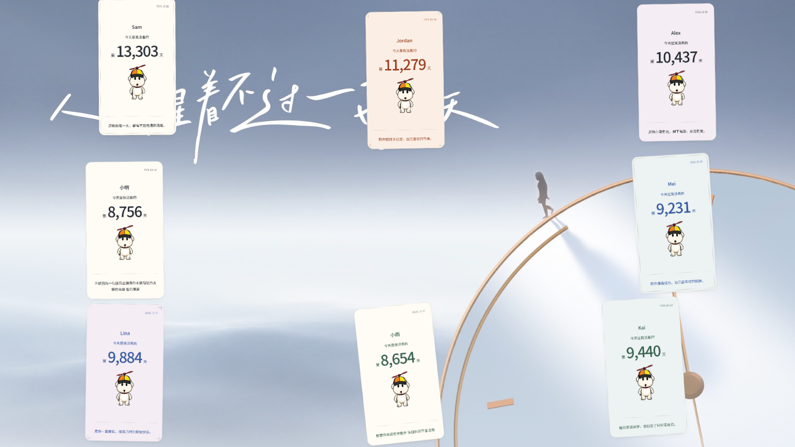

# 2. Big Screen

- **Who uses it:** everyone at the venue
- **Address:** [dior-fans-interact.vercel.app/screen](https://dior-fans-interact.vercel.app/screen)
- **Where it is opened:** the computer connected to the large display at the venue

The Big Screen brings guests' cards together in one place. Cards blow in from the right as if carried by the wind, float gently for a while, and then blow away to the left.

## What the audience sees

- **When no cards are showing:** the clock artwork background, the same one guests see on their phones.
- **When cards arrive:** each card blows in from the right side and settles into its own spot. Several cards can be on screen at the same time, and they never overlap.
- **Each card shows the full front:** date, name, 「今天是我活着的第 N 天」, 阿呆 and the guest's blessing. The design matches the colours the guest chose.
- **When time is up:** the card blows away to the left, and the next waiting card can take its place.

## How cards come and go

How cards move depends on the mode chosen in the [Staff Console](console.md).

=== "Auto mode (default)"

    - A new card goes up shortly after the guest submits it, as soon as there is a free spot.
    - Each card has its own timer. When its time is up, it leaves on its own.
    - If the screen is full, new cards wait in line. They never push off a card that is being shown for the first time.
    - Optional **replay**: when there are no new cards waiting, earlier cards can be shown again, one at a time. A replayed card makes way at once when a new card is waiting.

=== "Manual mode"

    - Cards wait until staff press the release button in the console.
    - Each press sends up a batch of the earliest waiting cards together.
    - A countdown appears at the bottom centre of the screen. When it reaches zero, the whole batch blows away.
    - Releasing a new batch replaces the batch on screen.

## Things to know

- **Anyone can open this page.** No password is needed, because it is meant for the audience. It only shows the cards currently on screen.
- **Sound:** the background song plays here too. Browsers require one click on the page before sound can start, so click the screen once after opening it. A speaker button appears when the mouse moves over the page. Staff can also turn the big screen's music on or off from the console.
- **Keep the page visible.** To save resources, the page stops updating while its browser tab is hidden or minimised. On the event computer, keep the page open and in front, ideally in full-screen mode.
- **Recovers by itself.** If the page is refreshed or the network drops briefly, it picks up where it left off, with the same cards and the same remaining time. No staff action is needed.
