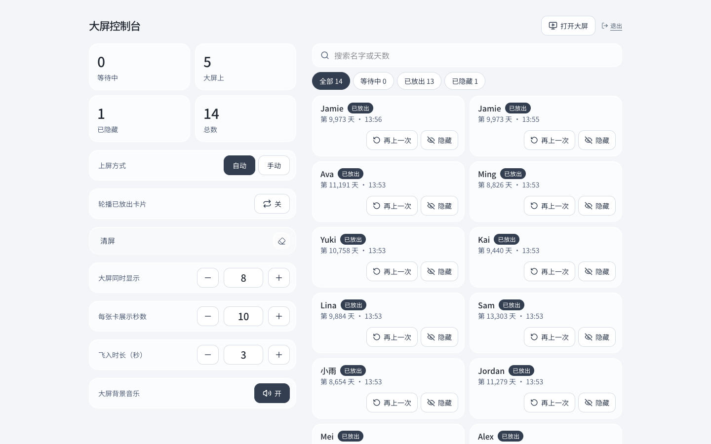

# 3. Staff Console

- **Who uses it:** event staff
- **Address:** [dior-fans-interact.vercel.app/admin](https://dior-fans-interact.vercel.app/admin)
- **Where it is opened:** any computer or phone. On a computer, controls are on the left and the card list is on the right; on a phone everything is in one column.

The Staff Console is where staff decide what the Big Screen shows and how. Every change takes effect on the Big Screen within a few seconds.

## Signing in

The console is protected by a staff key shared with the event team. Enter it and press **Enter** (进入). The key is remembered only in that browser tab; closing the tab signs out. **Sign out** (退出) is in the top-right corner, next to **Open big screen** (打开大屏), which opens the Big Screen in a new tab.

## Card counts

Four numbers at the top refresh every few seconds:

| Label | Meaning |
| --- | --- |
| **Waiting** (等待中) | Submitted cards that have not been on the big screen yet |
| **On screen** (大屏上) | Cards on the big screen right now |
| **Hidden** (已隐藏) | Cards that staff have hidden |
| **Total** (总数) | All cards submitted |

## Controls

| Control | What it does | Default |
| --- | --- | --- |
| **Mode** (上屏方式): Auto (自动) / Manual (手动) | **Auto:** cards go up by themselves as guests submit them. **Manual:** cards wait until staff release them. | Auto |
| **Release N cards** (放出 N 张卡片) | Manual mode only. Sends the earliest waiting cards to the big screen as one batch, up to the number allowed on screen. | |
| **Replay released cards** (轮播已放出卡片): On / Off | Auto mode only. When no new cards are waiting, earlier cards are shown again one at a time, starting with the one shown longest ago. Replayed cards make way at once for new cards. Hidden cards are never replayed. | Off |
| **Clear screen** (清屏) | Blows every card off the big screen. In auto mode it also pauses new cards; a **Resume** (继续上屏) button then appears to start again. | |
| **Cards on screen at once** (大屏同时显示) | How many cards can be on the big screen together. Use the minus and plus buttons or type a number. Cards already on screen glide smoothly to their new spots. More cards means each card is smaller. | 12 |
| **Display seconds** (每张卡展示秒数 / 每批展示秒数) | How long each card (auto mode) or each batch (manual mode) stays after it has landed. Minimum 5 seconds; plus and minus change it by 5, or type any number. | 10 seconds |
| **Fly-in time** (飞入时长) | How long a card takes to blow in, from 1 to 15 seconds in half-second steps. Only affects cards that arrive after the change. Blowing away always takes about 1 second. | 3 seconds |
| **Big screen music** (大屏背景音乐): On / Off | Turns the song on the big screen on or off remotely. The console itself does not play music. | On |

!!! tip "How long a card is on screen"
    In auto mode, a card stays on screen for roughly: a few seconds to arrive and settle, plus the fly-in time, plus the display seconds. The display time only starts counting once the card has landed.

## Card list

The right side (or lower part on a phone) lists every card with the guest's name, day count, status and the time it was submitted.

- **Search** by name or day count.
- **Filter** by status: All (全部), Waiting (等待中), Released (已放出), Hidden (已隐藏). Each filter shows how many cards it contains.
- The list shows 100 cards at a time; **Load more** (加载更多) shows the next 100.

Actions on each card:

| Action | What it does |
| --- | --- |
| **Hide** (隐藏) | Removes the card from the big screen straight away and keeps it from being shown again. Use it for inappropriate names. |
| **Restore** (恢复) | Brings a hidden card back. |
| **Show again** (再上一次) | For cards that have already been shown. Sends the card back to the waiting line, usually to the front, so it appears on the big screen again. |

!!! note "Messages in the console"
    - *"Connection lost, retrying"* (连接中断，正在重试): the console lost its connection and is reconnecting by itself.
    - *"Screen paused"* (已暂停上屏): the screen was cleared in auto mode. Press **Resume** to continue.
    - *"Action failed, please try again"* (操作失败，请再试一次): the last button press did not go through. Press it again.
