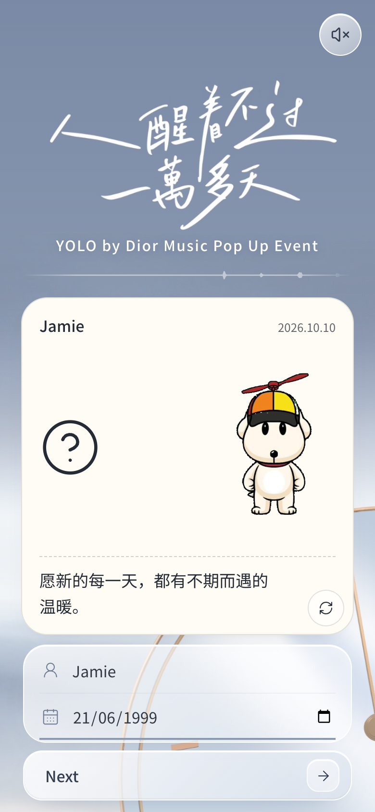
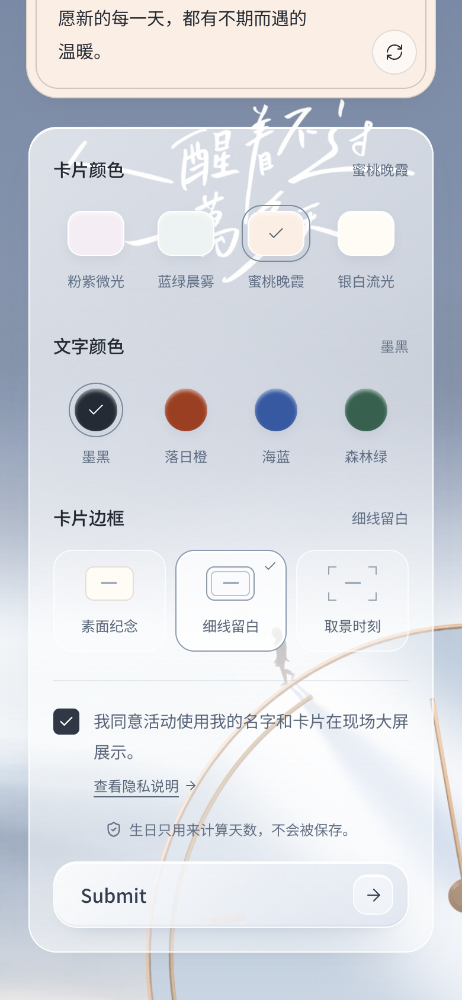
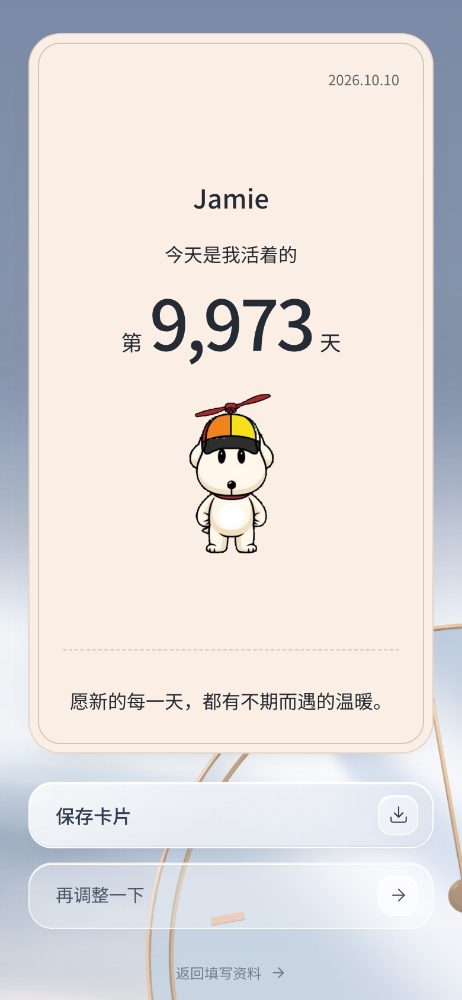

# 1. Participant Page

- **Who uses it:** guests, on their own phones
- **Address:** [dior-fans-interact.vercel.app](https://dior-fans-interact.vercel.app) (also `/participate`)
- **How guests get there:** by scanning the QR code printed at the venue

The Participant Page walks each guest through three short steps: **fill in**, **design**, and **reveal**. Everything happens on one page; there is no sign-up, no app to install and no email address required.

## Step 1: Your details

{ width="320" }

What the guest sees:

- The event artwork at the top, with the words 「人醒着不过一萬多天」 and the title **YOLO by Dior Music Pop Up Event**.
- A white sound wave under the title that moves with the background music.
- A live preview of their keepsake card.
- Two fields: **name or nickname** (你的名字或昵称) and **birthday** (shown as `dd/mm/yyyy`).
- A round speaker button in the top-right corner to pause or resume the music.

What the guest can do:

| Action | Result |
| --- | --- |
| Type a name | The name appears on the card preview straight away. |
| Tap the small circular arrow on the card | Shows a different blessing message. There are 18 to choose from. |
| Tap or swipe the card | Flips the card to see the back: 阿呆 sitting, signed **from Dior 大颖**. |
| Fill in both fields correctly | A **Next** button appears. It stays hidden until both fields are valid. |

The day count is **not** shown at this stage. A question mark sits in its place, keeping the number as a surprise until the card is submitted.

!!! info "Checks on the details"
    - The name cannot be empty and can be up to 30 characters.
    - The birthday must be a real date between 1 January 1900 and today. Future dates are not accepted.
    - If something is wrong, a short message appears under the field explaining what to fix.

!!! note "Background music"
    Browsers do not allow music to start on their own. The song starts the first time the guest taps the page. The speaker button only appears on this first step; the music keeps playing on the next steps.

## Step 2: Design your card

{ width="320" }

The guest designs the look of their card. Every choice updates the preview immediately.

| Option | Choices |
| --- | --- |
| **Card colour** (卡片颜色) | Pink lilac (粉紫微光), Blue mint (蓝绿晨雾), Peach rose (蜜桃晚霞), Pearl white (银白流光, default) |
| **Text colour** (文字颜色) | Ink black (墨黑, default), Sunset orange (落日橙), Ocean blue (海蓝), Forest green (森林绿) |
| **Border** (卡片边框) | Plain (素面纪念, default), Thin line (细线留白), Viewfinder corners (取景时刻) |

Below the options:

- A consent box: *"I agree that the event may show my name and card on the big screen at the venue."* A link next to it opens the privacy notice.
- A reminder that the birthday is only used to work out the day count and is not saved.
- **Submit** appears only after the consent box is ticked.
- A **back** link (返回资料) returns to Step 1 without losing anything that was entered.

While the card is being sent, the button shows *"Sending your keepsake"* (正在送出你的纪念). If the connection drops, the guest stays on this step and the button changes to **Try again** (再试一次). Pressing it twice never creates two cards.

## Step 3: Your keepsake card

{ width="320" }

After a successful submit, the day count is revealed on a large card:

- The guest's name, centred.
- 「今天是我活着的第 N 天」, which means *"Today is day N of my life"*, with the number in large type.
- Today's date in the top-right corner, 阿呆, and the chosen blessing.
- A line under the card: *"Your card has been sent to the big screen"* (你的卡片已送往现场大屏).

What the guest can do:

| Button or action | Result |
| --- | --- |
| **Save card** (保存卡片) | Saves the front of the card as a picture (1080 × 1440 pixels). On phones and tablets this opens the share menu, where the guest can save it to their photos or send it to friends. On computers the picture is downloaded. |
| Tap the card | Opens the card full screen. Tap or swipe to flip it; close with the X, by tapping outside the card, or with the Esc key. |
| Swipe the card | Flips it over without opening full screen. |
| **Adjust again** (再调整一下) | Goes back to Step 2 to change the design. |
| **Back to details** (返回填写资料) | Goes back to Step 1. |

!!! note "Going back hides the number again"
    If the guest goes back to change anything, the day count is hidden again behind the question mark. It is revealed again after the next Submit, and the new version is sent to the big screen.

!!! info "Nothing is stored on the phone"
    The name, birthday and design only stay on the page while it is open. Refreshing or closing the page clears them.
