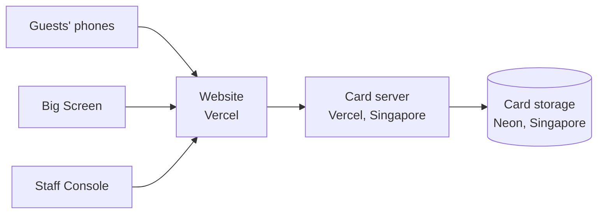

# Where It Runs

The experience runs entirely on established cloud services. There is no equipment to install at the venue apart from a computer and display for the Big Screen.

| Part | What it does | Service | Location |
| --- | --- | --- | --- |
| **Website** | Delivers the three pages (Participant Page, Big Screen, Staff Console) to phones and computers | [Vercel](https://vercel.com) | Worldwide delivery network, so pages load quickly wherever guests are |
| **Card server** | Receives submitted cards, works out the day count, and tells the Big Screen what to show | [Vercel](https://vercel.com) | Singapore |
| **Card storage** | Keeps the saved cards and the console settings | [Neon](https://neon.com) | Singapore |
| **This guide** | The document you are reading | [GitHub Pages](https://pages.github.com) | Worldwide |

## Why Singapore

The card server and card storage were placed together in Singapore, the closest region to the event. Keeping them close to each other and to the venue means cards are saved and appear on the big screen quickly.

## Addresses

| Page | Address |
| --- | --- |
| Participant Page | [dior-fans-interact.vercel.app](https://dior-fans-interact.vercel.app) |
| Big Screen | [dior-fans-interact.vercel.app/screen](https://dior-fans-interact.vercel.app/screen) |
| Staff Console | [dior-fans-interact.vercel.app/admin](https://dior-fans-interact.vercel.app/admin) |

## What the venue needs

- **Guests:** a phone with a camera to scan the QR code, and a mobile data or Wi-Fi connection.
- **Big Screen:** one computer with a modern web browser (such as Chrome), connected to the display and to the internet, with speakers for the music.
- **Staff:** any computer or phone with internet access to open the console.
